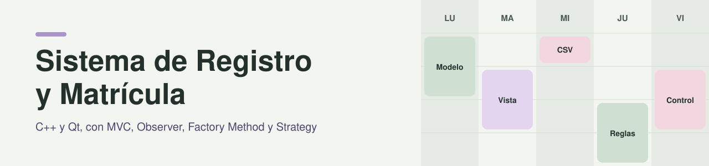
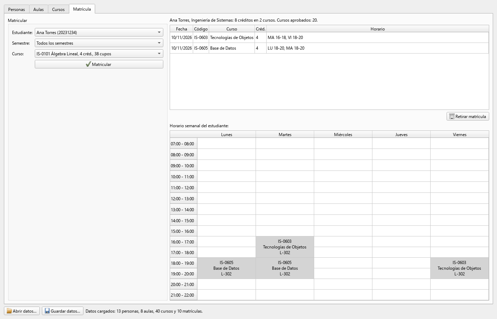
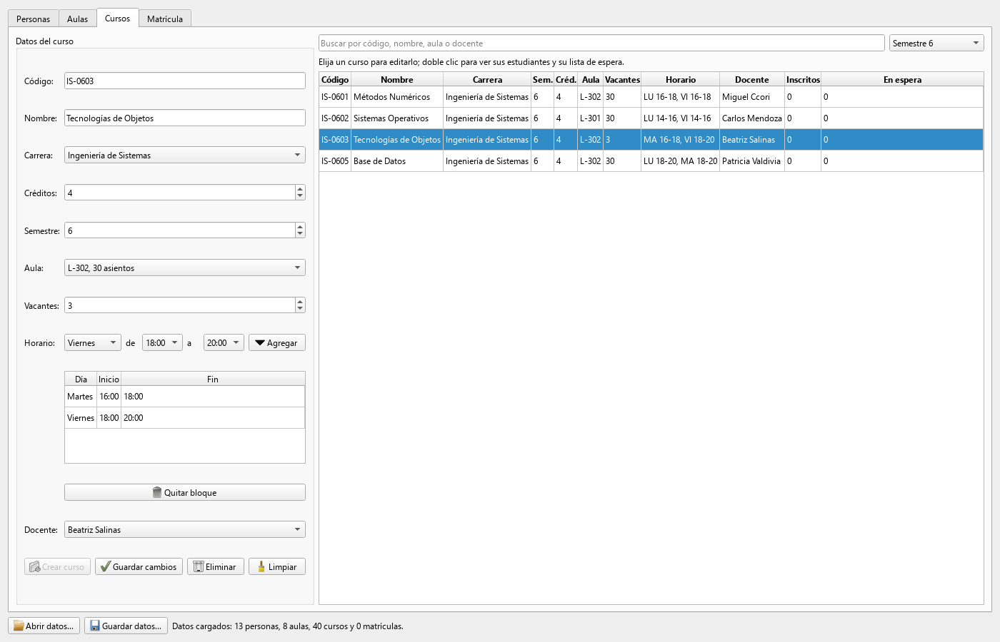
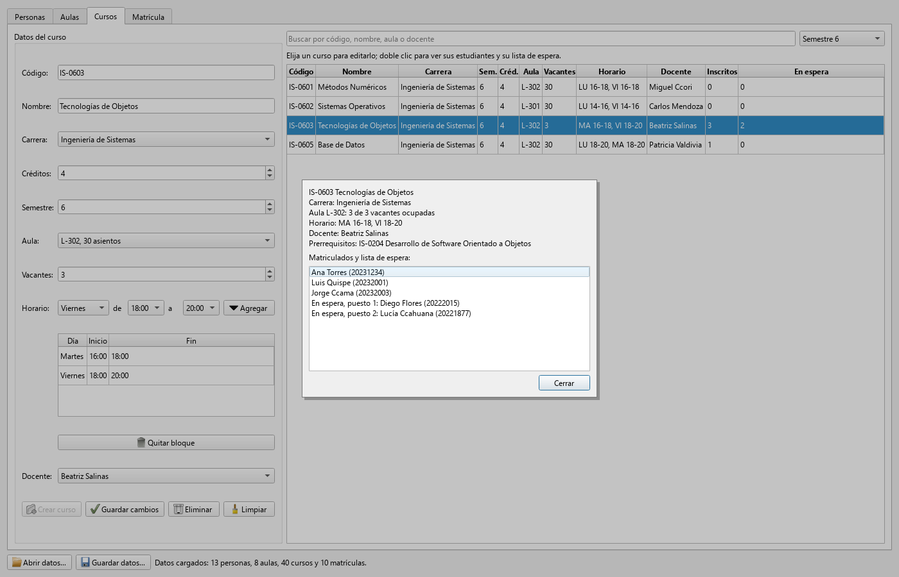
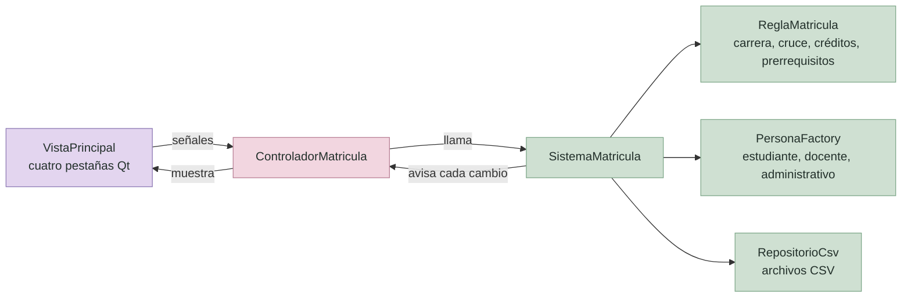

<p align="center">
  
</p>

<p align="center">
  
  
  
  
  
  
</p>

Aplicación de escritorio en C++ y Qt que registra estudiantes, docentes y personal administrativo, administra las carreras, las aulas y los cursos del plan de estudios, generales o de carrera, y matricula a los estudiantes con control de vacantes, carrera, cruce de horarios, límite de créditos, prerrequisitos y lista de espera.

<p align="center">
  
</p>

## Inicio rápido

| Paso | Qué hacer |
| :---: | --- |
| 1 | Instalar Qt 6 y Qt Creator: ver [Instalación](#instalacion) |
| 2 | Abrir `SistemaMatricula.pro` con **Archivo > Abrir proyecto** |
| 3 | Pulsar **Ejecutar** (`Ctrl+R`) y, en la ventana, **Abrir datos…** para cargar un archivo de `datos` |

## Qué hace

| Pestaña | Para qué sirve |
| --- | --- |
| Personas | Registrar, editar y eliminar estudiantes, docentes y personal administrativo |
| Aulas | Registrar aulas con su capacidad y ver cuántos cursos usan cada una |
| Cursos | Crear y editar cursos con horario por bloques, aula, vacantes y docente |
| Matrícula | Matricular, retirar y ver la grilla semanal y la lista de espera de cada estudiante |

<table>
  <tr>
    <td></td>
    <td></td>
  </tr>
  <tr>
    <td align="center">Cursos del semestre 6, con uno en edición</td>
    <td align="center">Detalle de un curso lleno y su lista de espera</td>
  </tr>
</table>

## Arquitectura

El proyecto sigue el patrón Modelo-Vista-Controlador. El modelo no depende de Qt: guarda los datos y aplica las reglas.



| Patrón | Dónde | Para qué |
| --- | --- | --- |
| Factory Method | `PersonaFactory` | Crear personas por su tipo desde el formulario y desde el archivo |
| Observer | `SistemaMatricula` y `ControladorMatricula` | Actualizar la vista y guardar la sesión después de cada cambio |
| Strategy | `ReglaMatricula` y sus reglas | Agregar reglas de matrícula sin modificar el sistema |
| MVC | `modelo`, `vista`, `controlador` | Separar las reglas de la interfaz |

## Contenido

- [Requisitos](#requisitos)
- [Obtener el proyecto](#obtener)
- [Instalación](#instalacion)
- [Compilación y ejecución en Qt Creator](#qt-creator)
- [Compilación y ejecución desde la terminal](#terminal)
- [Estructura del proyecto](#estructura)
- [Problemas frecuentes](#problemas)
- [Referencias](#referencias)

<a id="requisitos"></a>

## Requisitos

| Herramienta | Versión mínima | Para qué sirve |
| --- | --- | --- |
| Compilador C++ (GCC / MinGW-w64) | Compatible con C++17 | Traduce el código fuente a un ejecutable |
| Qt | 6 (también funciona con Qt 5.15) | Biblioteca de interfaz gráfica (`QtWidgets`) |
| qmake | Incluido con Qt | Lee `SistemaMatricula.pro` y genera el `Makefile` |
| make / mingw32-make | Cualquiera reciente | Ejecuta el `Makefile` y compila los archivos |
| Qt Creator | Cualquiera reciente | Entorno de desarrollo para abrir, compilar, ejecutar y depurar el proyecto |
| GDB | Opcional | Depurador usado por Qt Creator |

<a id="obtener"></a>

## Obtener el proyecto

- **Sin Git:** en la página del repositorio de GitHub, pulsar **Code > Download ZIP** y descomprimir el archivo.
- **Con Git:** instalar [Git](https://git-scm.com/downloads) (en Windows, `winget install Git.Git`; en Ubuntu o Debian, `sudo apt install git`) y clonar el repositorio:

  ```sh
  git clone https://github.com/sebastiancq/Sistema-Matricula-TO.git
  ```

<a id="instalacion"></a>

## Instalación

<details>
<summary><b>Windows</b>, con MSYS2</summary>

En Windows se usa [MSYS2](https://www.msys2.org/), un entorno que instala el compilador, Qt y Qt Creator con un solo gestor de paquetes (`pacman`).

1. **Instalar MSYS2.** Descargar el instalador desde [msys2.org](https://www.msys2.org/) y dejar la carpeta predeterminada `C:\msys64`. También se puede instalar desde PowerShell con [winget](https://learn.microsoft.com/es-es/windows/package-manager/winget/):

   ```powershell
   winget install MSYS2.MSYS2
   ```

   `winget` viene incluido en Windows 11. En Windows 10, si no existe, se instala con «Instalador de aplicación» desde la [Microsoft Store](https://apps.microsoft.com/detail/9nblggh4nns1), o se usa directamente el instalador de msys2.org.

2. **Abrir la terminal correcta.** En el menú Inicio, abrir **MSYS2 UCRT64** (no "MSYS2 MSYS"). Todos los comandos de Windows de este documento se escriben en esa terminal.

3. **Actualizar MSYS2.** Si la terminal se cierra sola al terminar, volver a abrirla y repetir el comando hasta que no haya nada por actualizar:

   ```sh
   pacman -Syu
   ```

4. **Instalar el compilador, Qt 6, Qt Creator y el depurador:**

   ```sh
   pacman -S --needed mingw-w64-ucrt-x86_64-gcc mingw-w64-ucrt-x86_64-make mingw-w64-ucrt-x86_64-gdb mingw-w64-ucrt-x86_64-qt6-base mingw-w64-ucrt-x86_64-qt-creator
   ```

   Cada paquete puede consultarse en [packages.msys2.org](https://packages.msys2.org/), por ejemplo [qt6-base](https://packages.msys2.org/base/mingw-w64-qt6-base) y [qt-creator](https://packages.msys2.org/base/mingw-w64-qt-creator).

5. **Comprobar la instalación:**

   ```sh
   g++ --version
   qmake6 --version
   ```

Qt Creator se abre escribiendo `qtcreator` en la terminal MSYS2 UCRT64 o desde `C:\msys64\ucrt64\bin\qtcreator.exe`.

> **Alternativa:** el [instalador oficial de Qt](https://www.qt.io/download-qt-installer-oss) instala Qt, MinGW y Qt Creator sin MSYS2, pero pide crear una cuenta de Qt. Con esa opción, el proyecto se compila igual desde Qt Creator.

</details>

<details>
<summary><b>Linux</b>: Ubuntu, Debian, Fedora, Arch o CachyOS</summary>

Instalar el compilador, Qt 6 y Qt Creator con el gestor de paquetes de la distribución:

**Ubuntu o Debian** ([paquetes de Ubuntu](https://packages.ubuntu.com/)):

```sh
sudo apt update
sudo apt install build-essential qt6-base-dev qmake6 qtcreator
```

**Fedora** ([paquetes de Fedora](https://packages.fedoraproject.org/)):

```sh
sudo dnf install gcc-c++ make qt6-qtbase-devel qt-creator
```

**Arch, CachyOS o Manjaro** ([paquetes de Arch](https://archlinux.org/packages/)):

```sh
sudo pacman -S --needed base-devel qt6-base qtcreator
```

Comprobar la instalación:

```sh
g++ --version
qmake6 --version
```

</details>

<a id="qt-creator"></a>

## Compilación y ejecución en Qt Creator

Es la forma recomendada, porque Qt Creator configura el compilador y las bibliotecas de Qt automáticamente.

### Primera vez: elegir el kit de Qt 6

Un *kit* le indica a Qt Creator qué compilador, qué versión de Qt y qué depurador usar. El Qt Creator de MSYS2 trae kits para varias versiones, pero solo funciona el de Qt 6, porque es el único instalado:

| Kit | Estado |
| --- | --- |
| Desktop Qt **6.x.x** (shared) MinGW-w64 UCRT64 (MSYS2) | Correcto: muestra el número de versión |
| Desktop Qt (shared) MinGW-w64 UCRT64 (MSYS2) | Qt 5, no instalado: sin número y con ícono de advertencia |
| Kits MINGW64, CLANG64, *static* o Python | No instalados |

Antes de abrir el proyecto, dejar el kit de Qt 6 como predeterminado:

1. Abrir Qt Creator e ir a **Editar > Preferencias > Kits** (en inglés, *Edit > Preferences > Kits*).
2. Seleccionar **Desktop Qt 6.x.x (shared) MinGW-w64 UCRT64 (MSYS2)** y pulsar **Establecer como predeterminado** (*Make Default*).
3. Opcional: seleccionar cada kit con ícono de advertencia y pulsar **Quitar** (*Remove*), para que no aparezcan al configurar proyectos.
4. Pulsar **Aceptar**.

En Linux, Qt Creator suele crear un único kit «Desktop» con el Qt instalado. Si ese kit muestra advertencia, comprobar que `qmake6 --version` funcione en la terminal.

### Abrir y ejecutar el proyecto

1. Ir a **Archivo > Abrir proyecto** (*File > Open Project*) y elegir `SistemaMatricula.pro`. También se puede usar el botón **Abrir proyecto** de la pantalla de **Bienvenida**, en **Proyectos**.
2. En la pantalla **Configurar proyecto**, dejar marcado solo el kit de Qt 6 y pulsar **Configurar proyecto**.
3. Pulsar **Ejecutar** (botón de triángulo verde o `Ctrl+R`). Qt Creator compila el proyecto y abre el programa.

No usar **Archivo > Abrir archivo**: esa opción abre el `.pro` como texto en el editor (`QT += widgets`…) y no como proyecto, y el botón Ejecutar queda desactivado. Si pasa, cerrar el archivo y abrirlo con **Abrir proyecto**.

Si el botón **Ejecutar** aparece desactivado, el proyecto quedó con un kit no instalado:

1. Entrar a **Proyectos** (`Ctrl+5`) y, en *Compilar y ejecutar*, hacer clic en el kit de Qt 6 para activarlo.
2. Abajo a la izquierda, en el selector con ícono de monitor, elegir ese kit.

Para depurar, usar **Depurar > Iniciar depuración** (`F5`) y colocar puntos de interrupción con clic en el margen izquierdo del editor.

Qt Creator guarda su configuración local en `SistemaMatricula.pro.user` y compila en una carpeta `build`. Ninguno de los dos debe subirse al repositorio.

<a id="terminal"></a>

## Compilación y ejecución desde la terminal

Abrir la terminal en la carpeta del proyecto (en Windows, la terminal **MSYS2 UCRT64**; en Linux, una terminal normal).

En MSYS2 las unidades de Windows se escriben como `/c/...`, por ejemplo:

```sh
cd "/c/Users/usuario/Documentos/SistemaMatricula"
```

**Compilar el programa:**

```sh
qmake6 SistemaMatricula.pro
make
```

En Windows se usa `mingw32-make` en lugar de `make`.

**Compilar las pruebas del modelo**, que no dependen de Qt:

```sh
g++ -Iinclude pruebas/pruebas_modelo.cpp src/modelo/*.cpp -o pruebas_modelo
```

**Ejecutar:**

```sh
./SistemaMatricula
./pruebas_modelo
```

Las pruebas se ejecutan desde la carpeta del proyecto para que encuentren la carpeta `datos`.

<a id="estructura"></a>

## Estructura del proyecto

El proyecto sigue el patrón Modelo-Vista-Controlador y separa las declaraciones (`include/`) de las implementaciones (`src/`):

```text
SistemaMatricula/
├── SistemaMatricula.pro   Proyecto único de Qt Creator
├── README.md
├── include/               Archivos .h: qué puede hacer cada clase
│   ├── modelo/            Personas, cursos, horarios, matrícula y reglas
│   ├── vista/             Ventanas y diálogos de Qt
│   └── controlador/       Conecta la vista con el modelo
├── src/                   Archivos .cpp: cómo lo hace cada clase
│   ├── main.cpp
│   ├── modelo/
│   ├── vista/
│   └── controlador/
├── pruebas/               Pruebas del modelo, sin Qt
├── recursos/              recursos.qrc, datos incluidos en el ejecutable
└── datos/                 Archivos CSV de prueba
```

Al iniciar, el programa retoma la sesión anterior; la primera vez carga los datos de inicio de semestre incluidos en el ejecutable. Cada cambio se guarda en la sesión, dentro de la carpeta de datos de la aplicación del usuario.

Los archivos de `datos` se abren con **Abrir datos…** y cada uno sirve para probar una parte del sistema:

| Archivo | Contenido | Qué permite probar |
| --- | --- | --- |
| `01_inicio_semestre.csv` | Carreras, personas, aulas y 40 cursos, sin matrículas | Registrar y matricular desde cero |
| `02_matricula_en_curso.csv` | 10 matrículas y un curso lleno con 2 estudiantes en espera | Grilla semanal y orden de la lista de espera |
| `03_casos_limite.csv` | 15 matrículas y un estudiante con 23 de 25 créditos | Curso lleno, límite de créditos, cruce de horario, retiro con promoción y prerrequisitos |
| `04_archivo_danado.csv` | Un curso con un aula no registrada | Aviso de la línea con error sin perder los datos cargados |

<a id="problemas"></a>

## Problemas frecuentes

| Problema | Causa | Solución |
| --- | --- | --- |
| `qmake6: command not found` | La terminal no es la de MSYS2 UCRT64, o Qt no está instalado | Abrir **MSYS2 UCRT64** y repetir el paso 4 de la instalación |
| Al abrir el `.exe` con doble clic falta `libstdc++-6.dll` o `Qt6Core.dll` | Windows no encuentra las bibliotecas de MSYS2 | Ejecutar desde Qt Creator o desde la terminal MSYS2 UCRT64 |
| Qt Creator muestra el kit con un signo de advertencia | El kit apunta a una versión de Qt que no está instalada (por ejemplo, Qt 5) | Elegir el kit de Qt 6 |
| El `.pro` se ve como texto y Ejecutar está desactivado | Se abrió con **Abrir archivo** en lugar de **Abrir proyecto** | Cerrar el archivo y usar **Archivo > Abrir proyecto** |
| El botón Ejecutar está desactivado en Qt Creator | El proyecto se configuró con un kit de Qt 5 u otra variante no instalada | Dejar el kit «Desktop Qt 6.x.x» como predeterminado en **Editar > Preferencias > Kits**, activarlo en **Proyectos** (`Ctrl+5`) y elegirlo en el selector de abajo a la izquierda |
| `make: command not found` en Windows | En MSYS2 el comando se llama distinto | Usar `mingw32-make` |
| Las pruebas no encuentran los archivos CSV | Se ejecutaron desde otra carpeta | Ejecutar `./pruebas_modelo` desde la carpeta del proyecto |

<a id="referencias"></a>

## Referencias

- [MSYS2: instalación](https://www.msys2.org/)
- [Paquetes de MSYS2](https://packages.msys2.org/)
- [Documentación de Qt Creator](https://doc.qt.io/qtcreator/)
- [Documentación de Qt 6](https://doc.qt.io/qt-6/)
- [Manual de qmake](https://doc.qt.io/qt-6/qmake-manual.html)
- [Descarga de Qt (código abierto)](https://www.qt.io/download-open-source)
